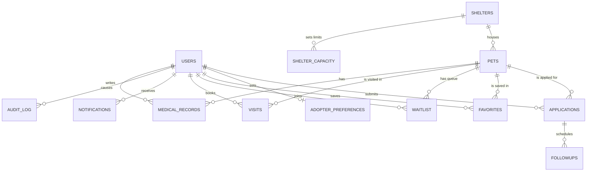

# Pawnest: Shelter and Adoption Hub

A web application, backed by a MySQL database, that connects animal shelters with adopters. Built as a DBMS project-based-learning assignment.

> Live demo: _add the link after deployment_  |  Team: see the table at the bottom

## 1. Problem statement
Animal shelters in a city usually run on paper, spreadsheets and WhatsApp groups. This causes four everyday problems:
1. **Nobody knows which shelter has space,** so some shelters overflow while others sit half empty.
2. **Animals that wait for months go unnoticed,** because nobody is tracking how long each one has been there.
3. **Adopters apply for animals that are not ready** (not vaccinated, still in quarantine), which wastes everyone's time.
4. **Matching is guesswork.** Adopters pick on looks, then return the animal when it does not fit their home.

## 2. Objectives
- Store animals, shelters, adopters, applications and health records in one consistent relational database.
- Show real-time **capacity per shelter and species** and warn before a shelter is full.
- **Flag long-stay animals** and let staff act on them (feature them, reduce the fee).
- Show an animal's **readiness** (vaccinated, behavior checked, treatment) and block applications for animals that are not ready.
- **Rank animals by compatibility** with each adopter's home and experience.
- Keep a complete **audit trail** and enforce business rules inside the database itself.

## 3. Why a relational database
- An animal belongs to exactly one shelter and an application links one adopter to one animal, which are classic foreign-key relationships.
- Two adopters can apply for the same animal. **Approving one must reject the others and mark the animal adopted as one all-or-nothing transaction.**
- Rules such as "a shelter cannot exceed its capacity" must hold no matter which program inserts the data, so they live in **triggers and constraints**, not only in the website.
- Reports (adoption rate per shelter, longest waiting animals) are natural SQL aggregates and window functions.

## 4. How the four core ideas map to the database
| Idea | Database objects |
|---|---|
| Capacity monitor | `shelter_capacity` table, `v_capacity` view, trigger `trg_pets_capacity` |
| Long-stay alert | `v_long_stay` view, index `idx_pets_status_intake`, function `fn_days_in_shelter` |
| Readiness status | `v_pet_readiness` view, trigger `trg_app_check`, medical records |
| Compatibility matching | stored procedure `sp_match_pets`, table `adopter_preferences` |

## 5. Features
- **Three roles:** adopters, admins (shelter staff) and vets, each with different permissions. Admin and vet sign-up need a secret code checked on the server.
- Animals in **7 categories** (dogs, cats, rabbits, birds, guinea pigs, hamsters, turtles) across **9 shelters**, with breed portraits, optional photo upload and a shelter map.
- Application wizard with a stage tracker, meet-and-greet booking (double booking is impossible), waitlist for animals in quarantine, adoption certificate (PDF) and 7, 30 and 90 day follow-ups.
- Reports page with SQL aggregates and Chart.js charts, an audit log, notifications, optional email and WhatsApp alerts, and an English / Hindi / Marathi switch.

## 6. Database at a glance
**14 tables, 4 views, 4 triggers, 2 stored procedures, 1 stored function, 16 foreign keys and 5 CHECK constraints.**
- Triggers: `trg_pets_capacity` (capacity), `trg_app_check` (only available animals can be applied for), `trg_app_audit` (logs status changes), `trg_pet_available` (notifies the first person on the waitlist).
- Procedures: `sp_approve_application` (transaction: approve, reject the rest, mark adopted, schedule follow-ups) and `sp_match_pets` (compatibility ranking).
- Views: `v_capacity`, `v_long_stay`, `v_pet_readiness`, `v_shelter_stats`.
- ER diagram: [docs/ER_DIAGRAM.md](docs/ER_DIAGRAM.md). Normalization: [docs/NORMALIZATION.md](docs/NORMALIZATION.md). Demo queries: [sql/demo_queries.sql](sql/demo_queries.sql).


Full diagram with every column: [docs/ER_DIAGRAM.md](docs/ER_DIAGRAM.md).

## 7. Tech stack
| Layer | Tools |
|---|---|
| Database | MySQL 8, MySQL Workbench |
| Backend | Python 3.11, Flask, mysql-connector-python (raw parameterised SQL), Pillow |
| Frontend | HTML, CSS, JavaScript (no framework), Chart.js |
| Tools | VS Code, Git and GitHub |

## 8. Project structure
```
pawnest/
├── app.py                 # Flask app: accounts and login
├── api_core.py            # animals, applications, visits, notifications, preferences
├── api_extras.py          # reports, matching, waitlist, medical records, follow-ups, certificate
├── api_vet.py             # vet queue
├── db.py                  # connection pools (one per database role)
├── mailer.py              # optional email / WhatsApp alerts
├── sql/                   # run in numeric order
│   ├── 01_schema.sql ... 08_cleanup_views_indexes.sql
│   ├── 09_roles_optional.sql
│   └── demo_queries.sql
├── static/                # index.html, css/style.css, js/app.js, js/chart.umd.js
├── docs/                  # ER diagram, normalization notes, screenshots
├── requirements.txt
└── .env.example
```

## 9. Run it locally (Windows)
1. Install Python 3.11+, MySQL Server 8 and MySQL Workbench.
2. Clone the repo, then in a terminal inside the folder:
   ```
   python -m venv venv
   venv\Scripts\activate
   pip install -r requirements.txt
   ```
3. In Workbench, connect as root and run the files in `sql/` **in order, 01 to 08**. Then create the app user:
   ```sql
   CREATE USER 'pawnest_app'@'localhost' IDENTIFIED BY 'choose-a-password';
   GRANT SELECT, INSERT, UPDATE, DELETE, EXECUTE ON pawnest.* TO 'pawnest_app'@'localhost';
   ```
4. Copy `.env.example` to `.env` and fill in `DB_PASSWORD`, a long random `SECRET_KEY` (`python -c "import secrets;print(secrets.token_hex(32))"`), `ADMIN_CODE` and `VET_CODE`.
5. Run `flask run` and open <http://127.0.0.1:5000>. Register an adopter, or an admin using your `ADMIN_CODE`.

`09_roles_optional.sql` creates separate low-privilege MySQL users for admin, adopter and vet requests (least privilege). It is optional; the `.env.example` explains the extra settings.

## 10. Cloud database (Aiven MySQL)
1. Create a free MySQL service on Aiven and a database named `pawnest` from its console.
2. Put the service host, port, user and password into `.env` as `DB_HOST`, `DB_PORT`, `DB_USER`, `DB_PASSWORD`, and set `DB_NAME=pawnest`.
3. Import `sql/01` to `08` with the `mysql` command-line client (Aiven requires an SSL connection, see its connection page) and start the app with `flask run`. The app now reads and writes the cloud database.
4. Credentials stay in `.env`, which is excluded by `.gitignore`.

## 11. Security notes
Passwords are stored as salted hashes. All SQL uses parameters, never string building. Secrets live in `.env`, not in the repo. Admin and vet codes are checked on the server. Login and registration are rate limited, and state-changing requests must be JSON.

## 12. Team
| Name | Role | Main contributions |
|---|---|---|
| Mahi Javale ([@mahieyayy](https://github.com/mahieyayy)) | Backend and database | Flask API, SQL scripts 01 to 08, triggers and procedures, README |
| Vaishvi Patel ([@vaishvipatel1301](https://github.com/vaishvipatel1301)) | Testing and frontend | Testing every page, screenshots, frontend notes |
| Saisha Deshpande ([@deshpandesaisha8](https://github.com/deshpandesaisha8)) | Queries and documentation | Demo queries, normalization review, viva notes |