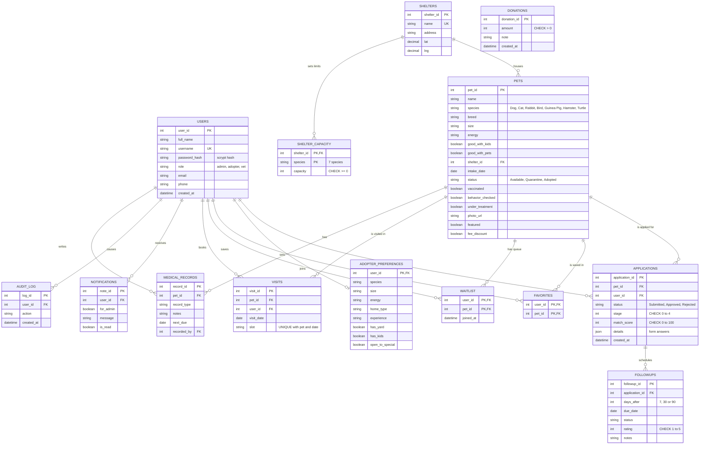

# Entity-Relationship diagram

## Relationships in words

| Relationship | Cardinality | Meaning |
|---|---|---|
| SHELTERS to PETS | 1 : many | An animal lives in exactly one shelter; a shelter houses many animals |
| SHELTERS to SHELTER_CAPACITY | 1 : many | One row per shelter and species, so any new animal category needs no schema change |
| USERS to APPLICATIONS | 1 : many | An adopter can apply for several animals |
| PETS to APPLICATIONS | 1 : many | Many adopters can apply for one animal; approving one rejects the rest |
| USERS to ADOPTER_PREFERENCES | 1 : 0..1 | An adopter has at most one saved preference profile |
| USERS and PETS through FAVORITES / WAITLIST | many : many | Resolved by tables whose primary key is the pair (user_id, pet_id) |
| APPLICATIONS to FOLLOWUPS | 1 : many | Approval creates three check-ins (7, 30, 90 days) |
| PETS to MEDICAL_RECORDS | 1 : many | Medical history entered by vets and admins |

DONATIONS stands alone on purpose: donors are anonymous and a demo checkout takes no payment details.
